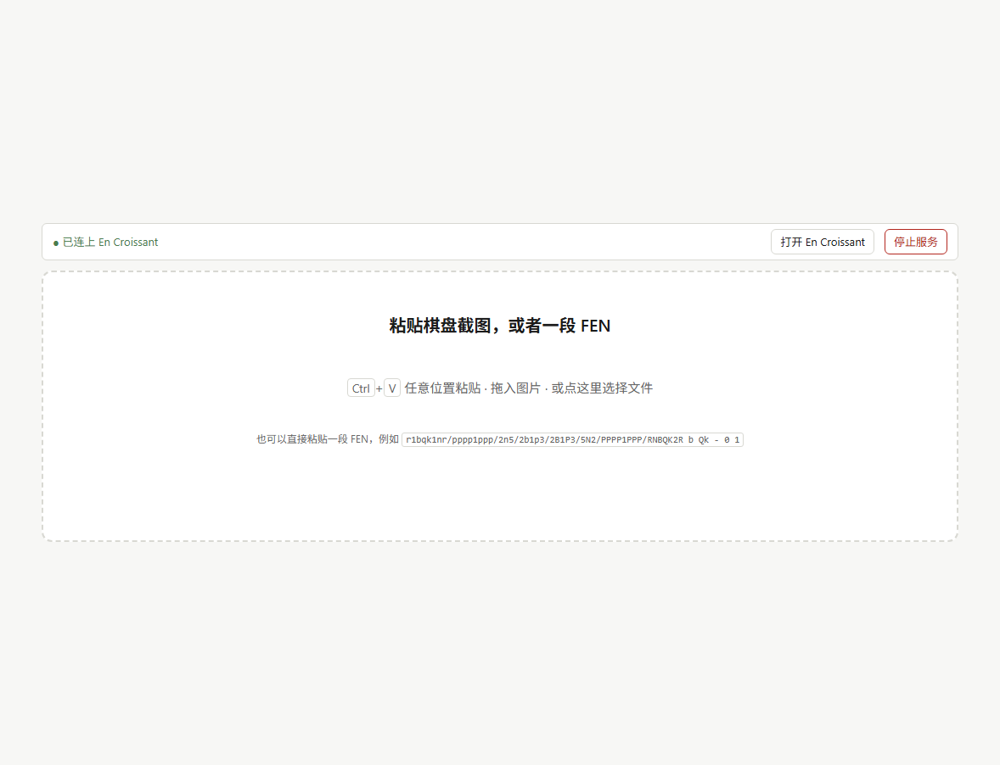

# Pt chess assistant

**Paste a chessboard screenshot (or a FEN / PGN) → get an editable board in the browser → hand the position to [En Croissant](https://www.encroissant.org) for Maia 3 / Stockfish analysis.**

Recognition, FEN assembly, PGN writing and engine launching all happen on your machine.
**The image never leaves the browser and is never uploaded anywhere.**

[中文文档](README.md)

**Try it online (static build, nothing to install)**: <https://pt-chess-assistant.ptlantern.workers.dev>



---

## Why this exists

- **En Croissant ships image import, but**: file picker only (no paste), side to move
  hard-coded to White, castling rights hard-coded to none.
- **Web analysis boards** need a network, upload your image, and cannot run a local Maia 3.
- **Maia 3 is a UCI engine**: it never sees images. The missing piece is exactly
  "screenshot → position".

This project is only that missing piece. Everything else is En Croissant's job.

## What it does

| | |
|---|---|
| **Paste a screenshot** | `Ctrl`+`V` / drag / file picker — an ONNX model runs locally in wasm |
| **Paste a FEN or PGN** | side to move and castling rights are taken verbatim; nothing is guessed |
| **Editable board** | palette stamping, right-click erase, **drag to move**, `Ctrl`+`Z` undo |
| **Inference** | side to move, castling rights and the en-passant target from the "last move" highlight |
| **Honest refusal** | low confidence / wrong king count / illegal FEN → visible warning, never silently sent to an engine |
| **Recent positions** | every recognised position is kept in localStorage; click to set it up again |
| **Shareable link** | the position is mirrored into the URL (`?fen=…`); "Copy link" gives someone the same position |
| **Low-confidence marks** | squares the recogniser was unsure about get a red dashed outline, with a count underneath |
| **Two languages** | UI in Chinese or English (`?lang=`, or your browser's language; switch in the footer) |
| **Hand-off** | writes a `[SetUp][FEN]` PGN and launches En Croissant with it |

## What it does not do

- No analysis UI of its own (that is En Croissant)
- No recognition model training (uses [`@scoriiu/fenshot`](https://github.com/scoriiu/fenshot))
- No bundled engine (Maia 3 / Stockfish are installed into En Croissant)
- No network calls (other than the `127.0.0.1` page you opened)

---

## Quick start

Requires **Node.js 22+**.

```bash
git clone https://github.com/LynPtl/Pt_chess_assistant.git
cd Pt_chess_assistant
npm install     # also copies the wasm runtime and the recognition model
npm run build
npm start       # serves and opens http://127.0.0.1:8787/
```

On Windows you can just double-click **`start.bat`** (it installs and builds on first run),
and **`stop.bat`** to stop the server. The page also has a "stop service" button.

One-shot setup:

```powershell
npm run setup      # Windows: node check + install + build + config.json
powershell -ExecutionPolicy Bypass -File scripts\setup.ps1 -All   # plus En Croissant, Stockfish, Maia 3
```

```bash
./scripts/setup.sh # macOS / Linux: page only, engines documented below
```

## Using it

1. Take a screenshot (`Win`+`Shift`+`S`) — or copy a FEN / PGN.
2. `Ctrl`+`V` on the page.
3. Check the board. **Editing is allowed and cheap**: pick a piece from the palette and click
   squares, right-click to erase, drag to move, `Ctrl`+`Z` to undo.
4. Verify three things: side to move, white/black **castling rights** (`还有` / `已失去`,
   with the inference marked inside the selected button), and the board orientation
   (the flip control is **display only** — it never changes the FEN).
5. Click **送入 En Croissant** (local) or **在 lichess 分析** (static build).

## Engines (optional)

- **En Croissant** (GPL-3) — the analysis GUI. Point `enCroissantPath` at its exe
  (use **forward slashes**: JSON reads `\n` in a Windows path as a newline).
- **Stockfish** — single exe, `MultiPV 3`, `Threads = physical cores`, `Hash 1024`.
  Measured on an i5-11300H: ~0.68M nps single-thread, ~2.2M nps with 4 threads.
- **Maia 3** — run it from its own venv; add `maia3-79m.exe` to En Croissant with
  **Go mode = Nodes 1** (it is a policy net, not a searcher: `depth` and `infinite`
  produce identical output). `Elo` / `SelfElo` / `OppoElo` pick whose moves you are modelling.

## Static deployment (Cloudflare)

Same code, one build flag:

```bash
npm run build:static     # emits dist-static/, no backend needed
npm run deploy:cf        # build:static + wrangler deploy
```

`wrangler.jsonc` declares `dist-static/` as the assets directory. Verified against a plain
static server and against the live URL with `node scripts/verify-static.mjs <url>`:
no local status bar, recognition works, no hand-off button, a lichess link instead,
and **zero requests to any local API**.

## Development

```bash
npm test                 # 199 unit tests (node:test), ~1s
npm run verify           # real browser: stamp/erase/drag/undo/Ctrl+Z/notices (needs npm start)
npm run verify:fen       # real browser: FEN paste
node scripts/verify-static.mjs <url>   # static build (local or live)
```

Browser regressions drive **Chrome DevTools Protocol** directly (no Playwright): Playwright was
excluded by the dependency budget, and `chrome --dump-dom` returns at load time, long before the
asynchronous wasm recognition finishes.

`?fixtures=1` runs 11 real screenshots through the production recognition path;
`?selftest=<file>` runs one.

## Known limits

- **2D, top-down boards only** (screenshots, app captures, book diagrams). Angled photos of
  a physical board are out of scope.
- Unusual piece sets are **refused** (`reliable: false`) rather than guessed.
- Side to move, castling and en passant come from the "last move" highlight plus geometry —
  always suggestions, always one click away from being overridden.
- En Croissant opens a **new window per hand-off** (its single-instance guard does not hold
  in practice, and its deep link only accepts chess.com/lichess URLs). There is a
  "close the old window first" checkbox next to the button.
- A hand-off does **not** auto-enable an engine; pick one in the Analysis tab once per tab.
- Depends on two undocumented En Croissant behaviours: opening a file from the command line,
  and reading `[SetUp]/[FEN]` PGN headers.

## Licence

Code is **MIT**. Third-party parts are permissive:

| Component | Licence |
|---|---|
| `src/pieces/spatial/*.svg` (Spatial set by Maurizio Monge, via lichess-org/lila) | MIT |
| [@scoriiu/fenshot](https://github.com/scoriiu/fenshot) | MIT |
| [onnxruntime-web](https://github.com/microsoft/onnxruntime) | MIT |
| [chess.js](https://github.com/jhlywa/chess.js) | BSD-2-Clause |
| `test/fixtures/*.png` (from fenshot's test corpus) | MIT |

See `LICENSE` and `src/pieces/NOTICE.md`.
