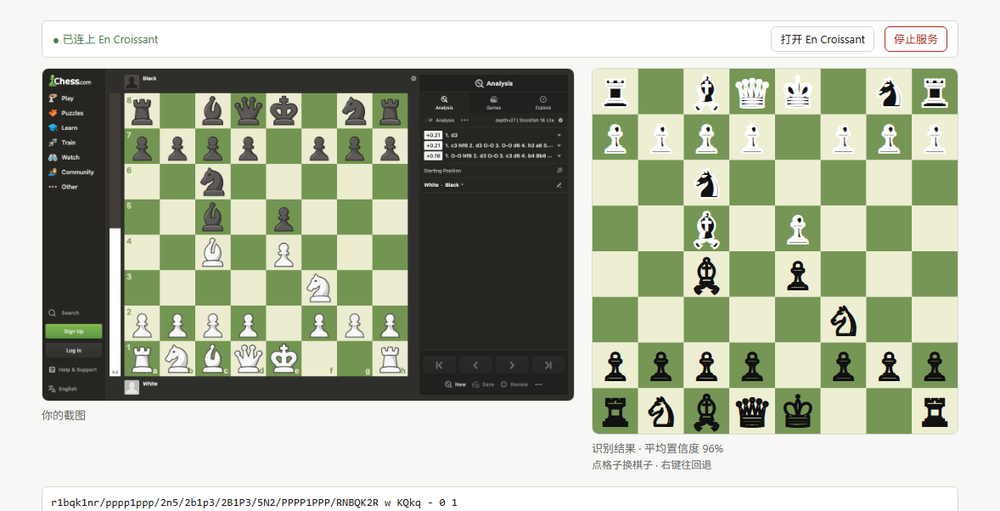

# mychess — 粘贴截图，摆好棋，交给 En Croissant 分析

粘贴（或拖入）一张棋盘截图 → 本地识别成**语义正确**的 FEN → 一键送进
[En Croissant](https://www.encroissant.org)，在那里用 Stockfish / Maia 3 分析。

识别、拼接 FEN、日志、启动分析器全部在本机完成，图片不出机器。

```
截图 ──粘贴──> 浏览器（fenshot 的 wasm 模型识别）──> FEN ──POST──> 本地 Node 服务
                                                                      │ 写 position.pgn
                                                                      └> en-croissant.exe position.pgn
```

本项目**不含分析界面**。分析界面是 En Croissant 的，我们只补它缺的那一段：
它自带的"图片导入"只能选文件，而且把走子方写死成白方、易位权写死成无。

---

## 它做什么 / 不做什么

做：

- 粘贴、拖入、或选择图片 → 识别棋盘
- 显示识别出的棋盘、平均置信度、原截图，供你核对
- **走子方**（白/黑）、**易位权**（按王车原位推断 / 一律无）、**旋转 180°** 三个开关
- 把 FEN 写成带 `[SetUp "1"][FEN "..."]` 的临时 PGN，命令行交给 En Croissant
- 每次识别写一行 JSONL 日志
- 不确定就明说：低置信度、王数不对、FEN 不合法都会挡在送出之前

不做：

- 不写分析界面、不写引擎前端
- 不 fork / 不修改 En Croissant
- 不安装或代管引擎
- 不做对局列表 OCR、不读截图里的着法
- 不联网（除了你打开的 `127.0.0.1`）

---

## 安装

前置：[Node.js](https://nodejs.org) 22+（开发时用的是 v24.20.0）。再装 [En Croissant](https://www.encroissant.org)。

```bat
git clone <this repo> mychess
cd mychess
npm install
npm run build
```

`npm install` 会把 onnxruntime 的 wasm 与 fenshot 的模型（约 14MB）同步到
`src/ort/`、`src/model/`（都被 gitignore）；`npm run build` 产出 `dist/`。

### 找到 En Croissant 的可执行文件路径

安装后一般是：

```
C:\Program Files\En Croissant\en-croissant.exe
```

在开始菜单里右键 En Croissant →「打开文件位置」，或到上面的目录里确认。
把路径填进配置（见下）。

### 配置

把 `config.example.json` 复制成 `config.json`，改成你的路径：

```json
{
  "enCroissantPath": "C:/Program Files/En Croissant/en-croissant.exe",
  "port": 8787,
  "pgnTempDir": "",
  "logPath": "logs/recognitions.jsonl"
}
```

| 键 | 含义 |
|---|---|
| `enCroissantPath` | En Croissant 的 exe 完整路径。**留空或路径不存在时，页面只给"复制 FEN"，不显示送入按钮** |
| `port` | 本地服务端口，默认 8787，只监听 `127.0.0.1` |
| `pgnTempDir` | 临时 PGN 目录；留空则用系统临时目录下的 `mychess-paste` |
| `logPath` | 识别日志，相对路径相对于 `config.json` 所在目录 |

`config.json` 与 `logs/` 都不进 git。

> **路径请用正斜杠（如上）。** JSON 把反斜杠后跟 n 当换行转义，所以写成
> `"C:\\Program Files\\nodejs\\node.exe"` 时，路径会被读成 `C:\Program` + 换行 + `odejs`……，
> 结果是“路径不存在”。本项目会直接报错让你改成正斜杠，而不是假装没配置。

---

## 怎么用（双击 start.bat 之后）

双击 `start.bat`，会弹一个黑色命令行窗口，里面写着：

```
  已经启动了：http://127.0.0.1:8787/
  这个黑色窗口就是服务本身，别关它（最小化就好）。
  En Croissant：已连上 —— C:/.../en-croissant.exe
```

**这个窗口就是服务本身，别关**（最小化就行）。它会自动打开浏览器到
`http://127.0.0.1:8787/`；没打开就自己把这个地址复制到浏览器。

看到这个页面就成了：


页面最上面有一条状态栏，先看它：

- **绿点 `● 已连上 En Croissant`** → 一切就绪，右边还能点「打开 En Croissant」直接把分析器打开
- **红点 `● 未连上`** → 后面会写明原因（没填路径 / 路径不存在 / config.json 写坏了），
  改好 `config.json` 后点「重新检测」即可，**不用重启**

### 1. 截图

`Win` + `Shift` + `S` 框选棋盘 → 截图进了剪贴板。

### 2. 回到浏览器，按 `Ctrl` + `V`

在页面任意位置按就行，不用点输入框。一秒左右出结果：



左边是你的原截图，右边是它读出来的局面，下方是 FEN。**先对一眼两边一不一样。**

### 3. 认错了就当场改

**右边的棋盘是浏览器现画的 SVG，不是你的截图**（左边那张才是截图），用的是
lichess 的 cburnett 棋子素材，黑白一眼能分开。

改法和 lichess / chess.com 的棋盘编辑器一样：**先选子，再盖章**。

1. 棋盘**下面**三行：第一行白子 ♔♕♖♗♘♙，第二行黑子 ♚♛♜♝♞♟，
   第三行一个小按钮 `⌫ 擦除`
2. 点一个棋子 → 它高亮（再点一次取消选中）
3. 点棋盘上的格子 → 就把那个子盖上去
4. **右键点格子 → 直接擦掉**（比先选擦除快）

改完 FEN、易位权、合法性警告会**立刻重算**（比如把 a8 的黑车擦掉，易位权会从
`KQkq` 变成 `KQk`），改好了再送。标题会标上「已手动修正」。

忘了先选子就点格子？它会提示「先在下面的调色板里选一个棋子」，不会静默无反应。

### 4. 核对这三件事

| 控件 | 什么时候要动 |
|---|---|
| **走子方** | **会自动推断**：棋子平台都会把上一步的两个格子染成黄绿，染色的那一格上站的是白子 → 说明白方刚走 → 轮到黑方。推断成功时标签会写「走子方（高亮格推断：白刚走）」，你点一下任一按钮就会覆盖它、标签也恢复成「走子方」。截图里没有高亮（静态图、书上的棋谱图）时回落到白方 |
| **易位权** | **每一侧各一组「有 / 无」**，推断结论写在**被选中那个按钮里面**：<br>`白方易位 [有 KQ 推断][无]` — 有权利，推断出的字母直接显示在「有」上<br>`黑方易位 [有][无 推断]` — 没权利（王不在 e8），角标落在「无」上<br>悬停那个「推断」角标会说明依据（"王和车都在原位"、"上一步动过 e1 的王"）。你一点按钮就变成明确指定、角标消失。**位置上根本做不到的那一侧，「有」是灰的**（比如王已不在 e1） |
| **旋转** | 棋盘上下颠倒了才点。黑白视角的截图它会自动判断 |

### 5. 点「送入 En Croissant」

### 5. 点「送入 En Croissant」

它会：写一个带 `[SetUp][FEN]` 的临时 PGN → 启动 En Croissant 打开它 →
页面显示"已送入 En Croissant"。

En Croissant 窗口里会出现一个叫 **`Pasted position`** 的标签页，棋盘上就是刚才那个局面。

### 如果状态栏是红的

`reason` 会直接告诉你哪一步不对，例如：

```
● 未连上 En Croissant —— enCroissantPath 指向的文件不存在：C:/wrong/place/en-croissant.exe    [重新检测]
● 未连上 En Croissant —— 无法解析配置文件 D:\mychess\config.json: Expected property name...  [重新检测]
```

按提示改 `config.json`（**路径用正斜杠**），存盘，点「重新检测」。服务会重新读这个文件，不用关窗口。

### 6. 在 En Croissant 里开引擎

**这一步每次都要点**（它不会自动开）：

右侧 **`Analysis`** 标签 → **`Engines`** 子标签 → 点底部 **`Manage Engines`**
左边那个选择器小图标 → 勾 **`Maia 3 (5M)`** 或 **`Stockfish`**。

Maia 3 大约 7 秒加载完（第一次更久，因为要读模型）；之后就能看到它认为"人类会走哪几步"。

> 像素里读不出**走子方**，也读不出**易位权是否已失效**。默认白方、按王车原位推断易位权，
> 界面上都会显示出来——这正是需要你核对的那两件事。

### 如果窗口里说端口 8787 被占用

说明之前开的 mychess 还活着。**不用管新窗口**，直接访问
[`http://127.0.0.1:8787/`](http://127.0.0.1:8787/) 用的就是那个实例。
要用新配置的话：先把旧的黑色窗口关掉，再重新运行 `start.bat`。

`start.bat` 本身是纯 ASCII 的（cmd 按控制台代码页读 .bat，中文写进去容易乱码甚至
导致命令解析出错），所有中文提示都由 Node 输出。

### 停止服务

三种方法，从最方便到最兜底：

1. **页面右上角点「停止服务」** —— 就近解决，不用离开浏览器（会问一次确认）
2. **关掉那个黑色窗口**（点 X，或 `Ctrl` + `C` 再按任意键）
3. **双击 `stop.bat`** —— 窗口找不到了就用这个

**最直接：关掉那个黑色窗口**（点 X，或 `Ctrl` + `C` 再按任意键）。node 就活在那个控制台里，
窗口一关它就停了。浏览器标签页可以留着，下次启动后刷新即可。

万一窗口找不到了 / 不确定还在不在跑，双击 **`stop.bat`**：它会查 8787 上是谁在监听，
确认是 `node.exe` 才杀，并打印结果。

```
[.] port 8787 is held by PID 22100
[.] stopped mychess (PID 22100)
```

如果占用者不是 node（比如别的程序恰好用了 8787），它会**拒绝**动手并显示是谁：

```
[!] that process is not node.exe, so it is not mychess.
    refusing to kill it. details:
Image Name                     PID Session Name        Session#    Mem Usage
python.exe                     180 Console                    1     22,768 K
```

命令行等价物：

```bat
netstat -ano | findstr ":8787" | findstr LISTENING   :: 看占用者的 PID
taskkill /F /PID <那个PID>                            :: 停掉它
```


## 在 En Croissant 里接上 Maia 3

Maia 3 是标准 UCI 引擎。**已经在本机装好了**（用独立 venv，没污染全局 Python）：

| | |
|---|---|
| venv | `C:/Users/ptlan/AppData/Local/maia3-venv` |
| 引擎可执行 | `C:/Users/ptlan/AppData/Local/maia3-venv/Scripts/maia3-5m.exe` |
| checkpoint 缓存 | `C:/Users/ptlan/.cache/huggingface/hub/models--UofTCSSLab--Maia3-5M/` |
| En Croissant 引擎列表 | `%APPDATA%/org.encroissant.app/engines/engines.json`（已有 Stockfish 19 与 Maia 3 (5M)）|

装法（要重装或换机型时照这个来）：

```bash
python -m venv C:/Users/ptlan/AppData/Local/maia3-venv
C:/Users/ptlan/AppData/Local/maia3-venv/Scripts/python.exe -m pip install torch   --index-url https://download.pytorch.org/whl/cpu        # CPU 版 ~200MB，2 分钟
git clone https://github.com/CSSLab/maia3.git
C:/Users/ptlan/AppData/Local/maia3-venv/Scripts/python.exe -m pip install ./maia3
C:/Users/ptlan/AppData/Local/maia3-venv/Scripts/maia3-cache.exe --model maia3-5m
```

**实测（本机 i5-11300H）**：`uci`/`uciok` 立刻返回，`isready` 后约 7 秒加载完模型并 `readyok`，
`go nodes 1` 给出 5 条 MultiPV 与 WDL，`bestmove e1g1`（意大利开局里 1500 Elo 会走的着法）。

```
info depth 1 multipv 1 score cp 26 wdl 502 22 476 pv e1g1
info depth 1 multipv 2 score cp 53 wdl 515 23 462 pv d2d3
...
bestmove e1g1
```

在 En Croissant 里启用：打开一个局面 → 右侧 **Analysis** 标签 → **Engines** 子标签 →
点底部 **Manage Engines** 左边的选择器图标（☰ 状）→ 勾选 **Maia 3 (5M)**。

> 注意：En Croissant 对命令行打开的局面**不会自动启用引擎**，每开一个新标签页都要勾一次。
> 这点在本机实测过（面板显示 `Engine isn't enabled`）。

Maia 3 的 `MultiPV` 给的是"人类大概会走的几步"，`Elo`/`SelfElo`/`OppoElo` 调预测对象；
它给的分是从 WDL 换出来的，**不是 Stockfish 那种搜索分**。`Threads`/`Hash` 对它不存在，
En Croissant 发过去会被忽略（无害）。

## 回归测试

```bat
npm run build
npm test                                  :: Node 侧单元测试
node scripts/browser-check.mjs "http://127.0.0.1:8787/?fixtures=1"
```

或起服务后用浏览器打开 <http://127.0.0.1:8787/?fixtures=1>，会看到一张表：
10 张图逐张跑**生产那条识别路径**，与 `test/fixtures/expected.json` 比对。
（其中 `lichess-user-1816.png` 是一张真机截图，也带着"上一步高亮"，用来守走子方推断。）

交互层还有一条回归：`node scripts/verify-interactions.mjs`。它用**真实鼠标事件**
点调色板、点格子、右键擦除、拖动换位，所以能抓到"重构把某个处理函数删了、页面静默失效"
这类单测覆盖不到的问题（真的抓到过一次）。

`scripts/browser-check.mjs` 是个无头 Chrome 检查器（走 DevTools 协议，
不依赖 Playwright）：等页面自己的完成信号再取结果，因为 `chrome --dump-dom`
在 load 时就返回，等不到 wasm 异步识别。

开发钩子（都在 `?selftest=` 分支里，不影响正常使用）：

| 参数 | 用途 |
|---|---|
| `?selftest=<文件名>` | 只跑一张 fixture，结果写进 `body[data-result]` 与页面上 |
| `&w=3840` | 把 fixture 放大到 3840 宽，模拟全屏截图 |
| `&crop=x,y,w,h` | 裁一块出来，模拟棋盘被裁掉/遮挡 |

测试图来自 [scoriiu/fenshot](https://github.com/scoriiu/fenshot) 的
`packages/fenshot/tests/fixtures/`（MIT）。

**许可**：本仓库代码为 MIT（见 `LICENSE`），但 `src/pieces/cburnett/*.svg`
这一组棋子素材是 **GPLv2+**，不受 MIT 覆盖 —— 要再分发（尤其公开仓库）请一并遵守。
两个依赖也都是宽松许可（fenshot 为 MIT）。

识别引擎是 [@scoriiu/fenshot](https://github.com/scoriiu/fenshot)（MIT）；
棋盘棋子是本仓库 `src/pieces/cburnett/` 里的 **cburnett** 棋子集，
作者 Colin M.L. Burnett，许可 **GPLv2+**，取自
[lichess-org/lila](https://github.com/lichess-org/lila) 的 `public/piece/cburnett`。
详见 `src/pieces/NOTICE.md`。

---

## 已知限制

**识别本身的边界**（fenshot 的能力边界，不是本项目的 bug）：

- 只认 2D 正视图：截图、书页棋谱图、App 截图。物理棋盘的斜拍照片基本无效
- 棋子集差异极大时会**拒绝**而不是猜（这是刻意的：`reliable: false`）
- 无兵残局里兵的方向没了，朝向判不出来，需要手动「旋转 180°」

**走子方与易位权**（像素里没有直接答案）：

- 走子方靠"上一步高亮"反推，**只是建议**：没高亮、或高亮格判不唯一（两格都有子）时回落到白方，标签也不会声称推断过
- 易位权先看位置（王在 e1/e8、车在角上），再用同一个"上一步高亮"缩小范围：
  高亮格里有王或某个角车 → 那个权利视为已失效。这修掉了最常见的错——"王出宫又回 e1"凭空多出易位权
- 反过来，如果截图上的高亮不是"上一步"（比如鼠标选中了棋子），这两处推断都会错——所以它们永远可被一键覆盖
- 吃过路兵与回合数固定写成 `- 0 1`

**Maia 3（已装并实测）**：5M / 23M / 79M 三个权重都可离线加载；按一次前向就出结果，
`go nodes 1` 与 `go depth 5` / `go infinite` 输出相同（它不是搜索型引擎）。缓存已热时
5M ≈ 3.2s、23M ≈ 3.5s、79M ≈ 4.3s —— 绝大部分是 Python + torch 启动，不是推理。

**实测结论（En Croissant 0.15.1，本机已装）**：

- **送入后不会自动开始分析。** 标签页会开出来、局面正确，但分析面板是空的，
  En Croissant 的 Engines 页显示 `No engine selected`。到 Analysis → Engines
  里选中你装好的引擎即可，之后每个新标签页都要选一次（或按你配置的默认引擎走）。
- **配置改动即时生效**：`/healthz` 每次请求都重新读 `config.json`，所以点「重新检测」就行；
  只有 `port` 改了才需要重启（端口在启动时就绑定了）。
- **每次送入都会新开一个窗口。** 虽然它带 `tauri-plugin-single-instance`，实测无效
  （第二次启动后连续 12 秒稳定留下 2 个进程）。**页面上有「先关掉旧窗口」勾选框**可解：
  勾上后先结束旧实例再启动（实测 PID 会变、只剩 1 个进程）。
  注意：旧窗口里未保存的分析会随之丢失。
- **深链方案不可行**（试过了，记在这里免得再试）：`encroissant://import?url=` 走的是
  `src/utils/import.ts#getGameFromUrl`，它只接受 chess.com / lichess.org 的 URL，
  本地 PGN 地址直接抛 `Failed to load game from unsupported URL`。所以没法把局面
  交给已经开着的那个窗口。

已验证的（在这台机器上跑过）：

- [x] 10 张 fixture 全部符合预期（白方视角、黑方视角、整屏双棋盘、无兵残局、
      非标准蓝色主题、异形棋子集诚实拒绝、无棋盘图拒绝）
- [x] 3840 宽输入 1.4 秒内出正确 FEN
- [x] 半张棋盘 → 三条警告 + 送入按钮置灰
- [x] 点「送入」→ 写 PGN → 启动真实进程（路径含空格）→ 页面显示"已送入"
- [x] 日志逐条落盘，字段固定
- [x] `enCroissantPath` 配错时只给"复制 FEN"，不报假成功
- [x] 真机端到端：装 En Croissant 0.15.1 → 送入 → 新窗口标签页 `Pasted position`
      里就是识别出的那盘棋（已截图确认盘面）
- [x] 引擎槽可用：Stockfish 19 被 En Croissant 正确识别（VERSION 19）
