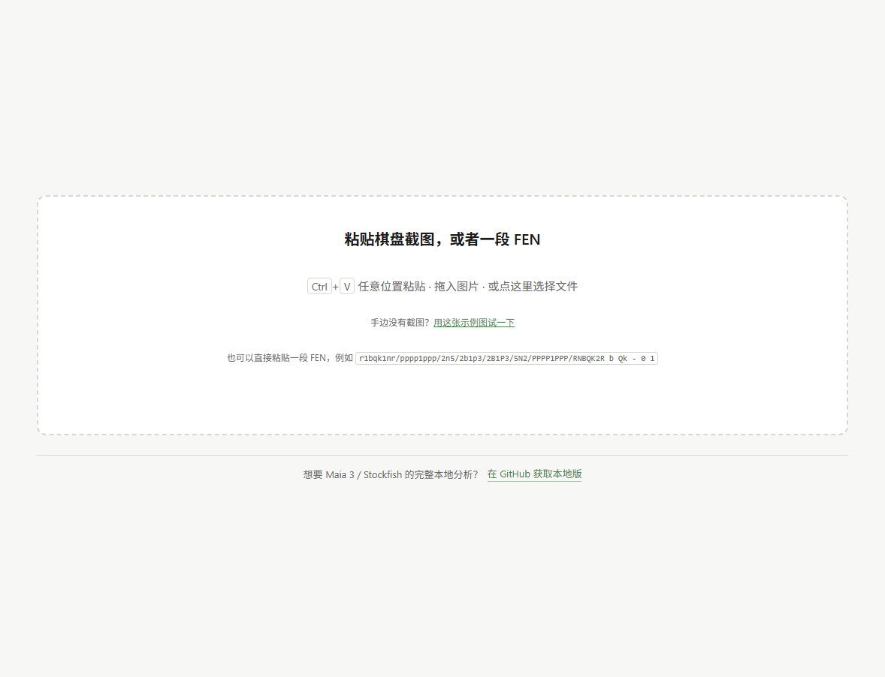
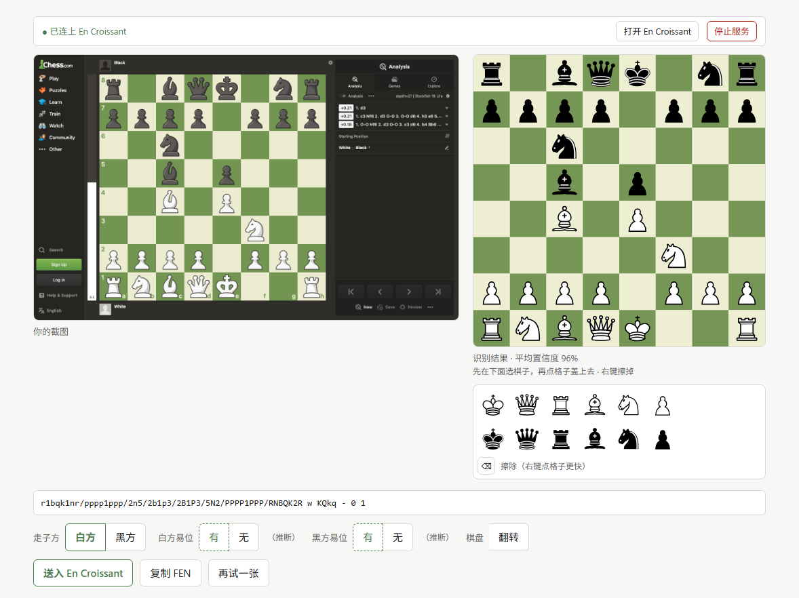

# Pt chess assistant

**粘贴一张棋盘截图（或一段 FEN）→ 在浏览器里摆好、改好 → 一键交给 [En Croissant](https://www.encroissant.org) 用 Maia 3 / Stockfish 分析。**

识别、拼 FEN、写 PGN、启动分析器全在本机完成，**图片不出浏览器、不上传任何服务器**。

**English**: [README.en.md](README.en.md)

线上版页脚有指向本仓库的链接（"想要 Maia 3 / Stockfish 的完整本地分析？在 GitHub 获取本地版"），
因为静态版做不了引擎分析，完整体验要本地跑。

**在线试（静态版，无需安装）**：<https://pt-chess-assistant.ptlantern.workers.dev>
—— 只能"贴图/贴 FEN → 摆好 → 复制 FEN 或去 lichess 分析"，没有本地引擎（那是设计如此）。



---

## 为什么需要它

- **En Croissant 自带图片导入，但**：只能选文件（不能粘贴），走子方写死成白方，易位权写死成无。
- **lichess 之类的在线分析**要联网、要上传图片、还没法接 Maia 3 这种本地引擎。
- **Maia 3 是 UCI 引擎**，本身不碰图片；缺的就是"截图 → 局面"这一段。

这个项目只补那一段，剩下的分析体验交给 En Croissant。

## 它能做什么

| | |
|---|---|
| **粘贴截图** | `Ctrl`+`V` / 拖入 / 选文件，浏览器里用 wasm 跑 ONNX 模型识别 |
| **粘贴 FEN / PGN** | 直接贴一段 FEN（4 段简写也认）或一整段 PGN（取最终局面）也行，走子方和易位权照抄不推断 |
| **可编辑棋盘** | 调色板盖章、右键擦除、**拖动换位**、`Ctrl`+`Z` 撤销（最多 30 步） |
| **推断** | 从"上一步高亮"推断走子方、易位权是否失效、吃过路兵目标 |
| **诚实拒绝** | 低置信度 / 王数不对 / FEN 不合法 → 显式警告，绝不静默把错局面送进引擎 |
| **最近局面** | 识别过的局面记在本地（localStorage），点一下重新摆出来 |
| **交接** | 写 `[SetUp][FEN]` 临时 PGN，命令行交给 En Croissant |

## 它不做什么

- 不写分析界面（用 En Croissant 的）
- 不训练识别模型（用 [`@scoriiu/fenshot`](https://github.com/scoriiu/fenshot) 的）
- 不内置引擎（Maia 3 / Stockfish 由你装进 En Croissant）
- 不联网（除了你打开的 `127.0.0.1`）

---

## 快速开始

需要 **Node.js 22+**。（22 是因为 `node --test` 的 glob 和 `import.meta.resolve`。）

```bash
git clone https://github.com/LynPtl/Pt_chess_assistant.git
cd Pt_chess_assistant
npm install     # 顺带把 wasm 运行时和识别模型复制进 src/ort、src/model
npm run build   # 产出 dist/
npm start       # 起服务并打开 http://127.0.0.1:8787/
```

Windows 上也可以双击 **`start.bat`**（首次会自动装依赖并构建），不想用了点页面右上角「停止服务」或双击 `stop.bat`。

### 一条命令装完（可选）

```powershell
# Windows：检查 Node、装依赖、构建、写 config.json
npm run setup
# 连本地引擎一起装（会下载 数百 MB）
powershell -ExecutionPolicy Bypass -File scripts\setup.ps1 -All
```

```bash
# macOS / Linux：只做"能跑起页面"的部分，引擎按下面自己装
./scripts/setup.sh
```

`setup.ps1` 支持单独开关：`-EnCroissant` / `-Stockfish` / `-Maia`，也可以 `-All`。它做的事都是幂等的，已装好的不会重装。

---

## 怎么用

### 1. 拿到一张截图

`Win`+`Shift`+`S` 框一下棋盘就行。或者直接从聊天记录里复制一段 FEN。

### 2. 回到页面按 `Ctrl` + `V`



左边是你的截图，右边是它画出来的棋盘。**先对一眼。** 也可以点「这里选择文件」或把图片拖进虚线框。

### 3. 认错了就当场改

右下那块棋盘是**浏览器现画的 SVG**，不是你的截图：

- **先在调色板选子**（白子一行、黑子一行），再点格子盖章；擦除是单独的小按钮
- **右键点格子**直接擦掉
- **拖动棋子**换到另一格
- **`Ctrl`+`Z`** 或调色板右侧的「↶ 撤销」退回上一步

改完 FEN、易位权、合法性警告会立刻重算。

### 4. 核对这三个开关

| 控件 | 说明 |
|---|---|
| **走子方** | 有高亮时自动推断（`高亮格推断：白刚走`）；没有或判不唯一就默认白方。点一下就覆盖推断。**黑方视角的截图也能正确推**（高亮格会先按朝向转 180° 再查棋子） |
| **白方/黑方易位** | 位置 + 高亮共同推断，结论写在**被选中那个按钮里面**（如 `有 推断`）。位置上做不到的那一侧，「有」是禁用的 |
| **翻转** | **只影响怎么画，不改 FEN**：走子方、易位权、复制/送出的 FEN 一个字都不会变。黑方视角的截图它会自动以黑方为准显示，点一下切到白方视角 |

### 5. 送入 En Croissant

点「送入 En Croissant」→ 它写一个临时 PGN 并启动 En Croissant → 出现一个 `Pasted position` 标签页，就是当前局面。

> **每次送入都会新开一个窗口**（En Croissant 的单实例保护实测无效，深链又只认 chess.com/lichess 的 URL，没法把局面交给已开着的窗口）。勾上送入旁边的「**先关掉旧窗口**」就会先结束旧实例——注意旧窗口里未保存的分析会丢。

### 6. 在 En Croissant 里开引擎

**这一步每次都要点**（它不会对命令行打开的局面自动启用引擎）：

右侧 `Analysis` → `Engines` 子标签 → 点底部 `Manage Engines` 左边的选择器图标 → 勾选你要的引擎。

---

## 装上引擎（可选，但这是分析的主力）

### En Croissant（分析界面本体，GPL-3）

从 <https://www.encroissant.org> 或 [Releases](https://github.com/franciscoBSalgueiro/en-croissant/releases) 下载安装。
装好后把可执行文件路径填进 `config.json`：

```powershell
Get-ChildItem "$env:LOCALAPPDATA\Programs","C:\Program Files" -Filter en-croissant.exe -Recurse -ErrorAction SilentlyContinue |
  Select-Object -First 1 -ExpandProperty FullName
```

**路径请用正斜杠**：JSON 会把反斜杠 + n 当换行，写成 `C:\\Program Files\\...` 才对，最省事是 `C:/Program Files/...`。
本项目会检测这个坑并直接报错，不会假装没配置。

### Stockfish（"基本拿到最优解"的那个）

下载 `stockfish-windows-x86-64-*.zip` 解开即可，单文件、无需安装：
<https://github.com/official-stockfish/Stockfish/releases>

在 En Croissant 里：`MultiPV 3` / `Threads = 物理核心数` / `Hash 1024` / Go 模式 `Infinite`。
参考性能（i5-11300H）：单线程约 68 万节点/秒，4 线程约 225 万节点/秒。

### Maia 3（预测"人类会怎么走"）

独立 venv，别污染全局 Python：

```bash
python -m venv ~/maia3-venv
~/maia3-venv/Scripts/python.exe -m pip install torch --index-url https://download.pytorch.org/whl/cpu   # CPU 版约 200MB
git clone https://github.com/CSSLab/maia3.git
~/maia3-venv/Scripts/python.exe -m pip install ./maia3
~/maia3-venv/Scripts/maia3-cache.exe --model maia3-79m    # 预下权重，否则引擎启动可能超时
```

在 En Croissant 里加 `maia3-79m.exe`，参数留空（别填 `.pt`，也别加 `--model`），
**Go 模式必须选 `Nodes = 1`**：Maia 是一次前向出结果，不是搜索型引擎，
`go depth` / `go infinite` 输出完全相同。选项建议：`MultiPV 3`、`Elo`/`SelfElo`/`OppoElo` 设成你在意的分档、`Temperature 0.0`、`TopP 1.0`。

实测（缓存已热）：5M ≈ 3.2s、23M ≈ 3.5s、79M ≈ 4.3s —— 绝大部分是 Python + torch 启动，不是推理，所以**直接用 79M**。

---

## 配置

把 `config.example.json` 复制成 `config.json`：

```json
{
  "enCroissantPath": "C:/Users/you/AppData/Local/en-croissant/en-croissant.exe",
  "port": 8787,
  "pgnTempDir": "",
  "logPath": "logs/recognitions.jsonl",
  "logMaxBytes": 2097152
}
```

| 键 | 说明 |
|---|---|
| `enCroissantPath` | exe 完整路径。**留空或文件不存在时，页面只给「复制 FEN」**，不显示送入按钮 |
| `port` | 默认 8787，只监听 `127.0.0.1` |
| `pgnTempDir` | 临时 PGN 目录，留空用系统临时目录下的 `mychess-paste` |
| `logPath` | 识别日志（一行一条 JSON） |
| `logMaxBytes` | 日志超过就轮转成 `.1`，只留一代 |

`config.json`、`logs/`、`dist/` 都不进 git。配置**改完即时生效**（每次 `/healthz` 都重读），页面点「重新检测」即可。

---

## 部署成纯静态版（Cloudflare）

同一份代码，一个构建开关就是两种形态。静态版**没有后端**：

- 识别、摆棋、编辑、拖动、撤销 —— 全在浏览器里，照旧
- 顶部那条「已连上 / 检测 / 停止服务」整条不渲染
- 结果页只剩 `复制 FEN` / `在 lichess 分析` / `再试一张`
- 首页多一个「用这张示例图试一下」，谁都能点开就看效果

```bash
npm run build:static     # 产物在 dist-static/；内部设 VITE_STATIC=1，不用额外环境变量
npx serve dist-static    # 本地看效果
```

**部署**（Cloudflare 已经把 Pages 并入 Workers，静态站点用 assets 声明）：

```bash
npx wrangler login       # 一次即可
npm run deploy:cf        # = build:static + wrangler deploy
```

`wrangler.jsonc` 里已经写好了 `assets.directory = ./dist-static` 与站点名 `pt-chess-assistant`。
**两个构建产物目录是分开的**（`dist/` 本地版、`dist-static/` 静态版），所以不会出现
"本地回归跑在静态产物上"或"把本地版推上线"这类乌龙。
首次部署会给出形如 `https://pt-chess-assistant.<你的子域>.workers.dev` 的地址。

> 以前那种 `wrangler pages deploy` 现在会被 wrangler 转交到 Workers 流程然后报
> "Missing entry-point"；用上面的 `wrangler deploy` + assets 即可。

**上线前值得跑一遍**（我每次部署都跑）：

```bash
node scripts/verify-static.mjs https://<你的地址>/
```

它验证：没有本地状态条、示例图可读、识别可用、没有「送入」按钮、给了 lichess 入口、
编辑仍然可用，以及**整个流程零请求打到 `/healthz`、`/handoff` 之类**。

两点差异要知道：

- `?fixtures=1` / `?selftest=` 在静态版里用不了 —— 它们读的是本地 Node 服务的 `/fixtures/*`
- 静态版没有引擎：分析交给「在 lichess 分析」（把当前 FEN 拼进 lichess 的 URL）

## 开发与测试

```bash
npm test                 # 177 条单元测试（node:test），1 秒
npm run build            # 生产构建
npm run verify           # 真实浏览器：盖章/擦除/拖拽/撤销/Ctrl+Z/提示条（需先 npm start）
npm run verify:fen       # 真实浏览器：粘贴 FEN 摆棋
npm run build:static     # 静态版构建（无后端）
npm run verify:static    # 静态版验收（dist/ 用任意静态服务器托管，或直接指线上地址）
```

浏览器回归用的是 **Chrome DevTools 协议**（不是 Playwright），原因有两个：Playwright 会被依赖约束排除；
而且 `chrome --dump-dom` 在 load 时就返回，等不到 wasm 的异步识别，必须挂到页面自己的完成信号上。

`?fixtures=1` 可以在页面里跑 10 张真实截图的识别回归；`?selftest=<文件名>` 只跑一张。

两种构建产物分别是 `dist/`（本地版）和 `dist-static/`（静态版），互不覆盖。

### 代码结构

```
src/
  main.js          页面编排：状态、扫描流程、渲染入口（~470 行）
  server.mjs       本地 HTTP 服务：静态文件 + /healthz /handoff /open /shutdown
  view.mjs         纯函数 HTML 构建（状态条、调色板、按钮、投放区）
  board.mjs        只读棋盘 SVG
  board-editing.mjs 盖章 / 擦除 / 拖拽的交互状态机
  board -> 数据：  fen.mjs（FEN 组装） castling.mjs（易位权） highlight.mjs（高亮推断）
                   import-fen.mjs（FEN 解析） guards.mjs（拒绝策略） edit.mjs（改格）
  service.mjs      与本地服务的所有请求
  mode.mjs         本地版 / 静态版的开关
  devhooks.mjs     ?fixtures / ?selftest 开发钩子
  sampling.mjs     像素采样（canvas）
  config.mjs / config 加载       spawn-helpers.mjs / 进程与端口错误
scripts/
  setup.ps1 setup.sh        一次性安装
  sync-assets.mjs           把 wasm 与模型复制进 src/（postinstall 自动跑）
  browser-check.mjs         无头 Chrome 的通用求值器
  verify-interactions.mjs   交互回归
  verify-fen-paste.mjs      FEN 粘贴回归
  verify-static.mjs         静态版回归（可指向线上地址）
  build-static.mjs          静态版构建（设 VITE_STATIC=1 后调 vite）
```

---

## 已知限制

**识别边界**（fenshot 的能力边界，不是 bug）：

- 只认 **2D 正视图**：网页截图、App 截图、书页棋谱图。**斜拍的实物棋盘不行**
- 棋子集差异极大时会**拒绝**（`reliable: false`），而不是猜
- 无兵残局里兵的方向没了，朝向判不出来 → 需要手动「旋转」

**推断都是"建议"**：

- 走子方、易位权、吃过路兵都靠"上一步高亮"配合位置判断
- 如果截图上的高亮不是"上一步"（比如鼠标选中了棋子），推断会错 —— 所以它们**永远可被一键覆盖**
- 回合数固定写 `0 1`（不影响分析）

**交接层的坑**（都实测过）：

- 每次送入新开一个窗口（见上文「先关掉旧窗口」）
- 送入后不会自动启用引擎，每个新标签页要手动勾一次
- 依赖 En Croissant 的两个未文档化行为：命令行打开文件、`[SetUp][FEN]` PGN 解析 —— 它升级后可能失效

---

## 许可

代码 **MIT**（见 `LICENSE`）。第三方组件全部宽松许可：

| 组件 | 许可 |
|---|---|
| `src/pieces/spatial/*.svg`（Spatial 棋集，Maurizio Monge，经 lichess-org/lila） | MIT |
| [@scoriiu/fenshot](https://github.com/scoriiu/fenshot)（棋盘检测 + 棋子分类） | MIT |
| [onnxruntime-web](https://github.com/microsoft/onnxruntime) | MIT |
| [chess.js](https://github.com/jhlywa/chess.js) | BSD-2-Clause |
| `test/fixtures/*.png`（取自 fenshot 的测试语料） | MIT |

想换棋集：任何一套 12 个 SVG 放进 `src/pieces/<名字>/`，改 `src/piece-urls.mjs` 的 import 路径即可
（`src/pieces/NOTICE.md` 里列了 lila 中其他宽松许可的棋集，以及哪些是 CC BY-NC-SA 不能用于开源项目）。

## 致谢

- [En Croissant](https://github.com/franciscoBSalgueiro/en-croissant) —— 分析界面
- [fenshot](https://github.com/scoriiu/fenshot) —— 截图识别（本项目最关键的那块）
- [lichess-org/lila](https://github.com/lichess-org/lila) —— 棋子素材
- [Maia Chess](https://github.com/CSSLab/maia3) / [Stockfish](https://github.com/official-stockfish/Stockfish) —— 引擎
